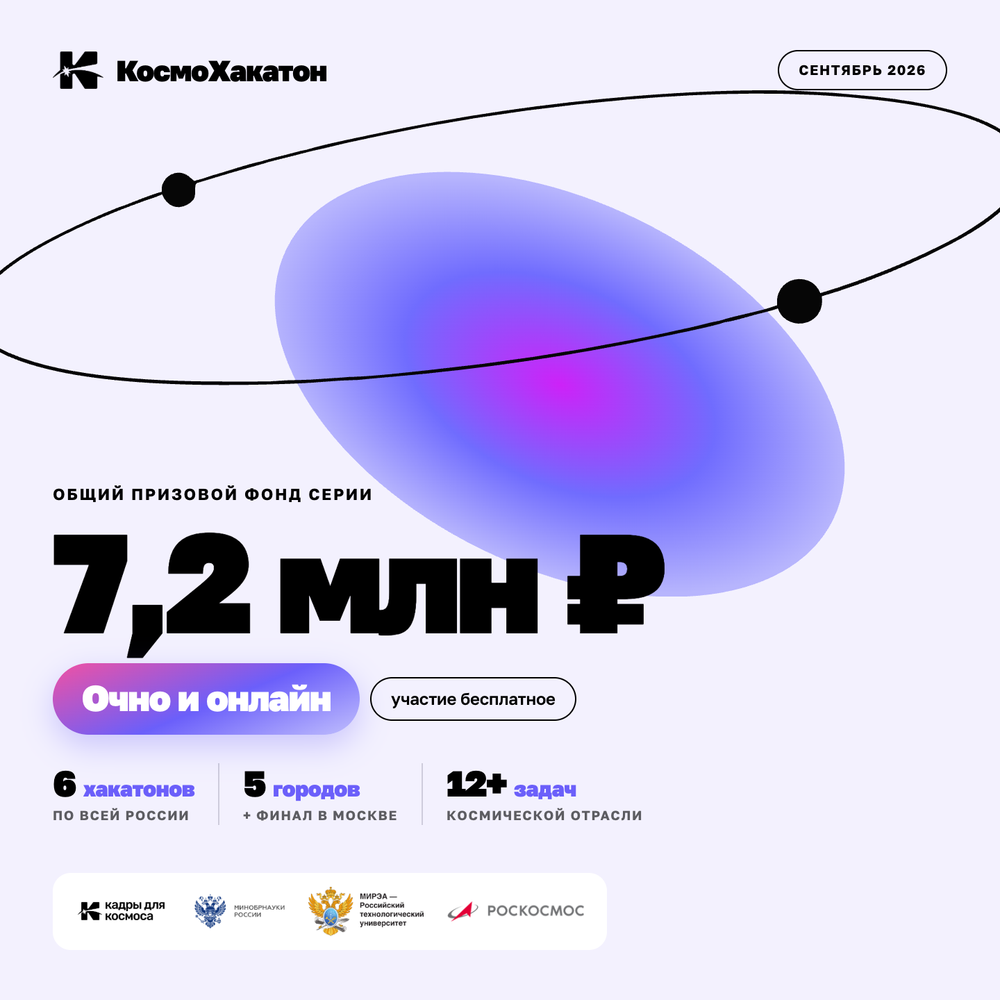

<h1 align="center">Hi  My name is Nikita</h1>

<h2 align="center">Front-end developer</h1> 

My journey into the world of programming began in my school years, when I started learning Python. When I entered the university, my knowledge expanded to languages such as C++, Java and Python. However, JavaScript really fascinated me, drawing me into the dynamic landscape of web development. I am currently focused on mastering React

### Skills

</a>

</a>  

### Badges

<!-- <b>My GitHub Stats</b>

 -->

  # [TECH SQUAD: МИССИЯ «ИИ» - 1 место 2025](https://it.fut.ru/event/gazprom-neft/tech-squad?utm_source=codenrock&utm_medium=banner&utm_campaign=promofree)

  
  

## Проблематика:

Создать прототип инструмента на основе искусственного интеллекта (ИИ), предназначенного для автоматизации анализа рентгенограмм сварных швов с целью снижения трудозатрат экспертов, исключения влияния человеческого фактора и ускорения процесса интерпретации дефектов.

---

## Ссылки:

- [Сертификат](https://github.com/BakSnn/BakSnn/blob/9328f88437dce22a582fd453733962bc22258cb4/%D0%94%D0%9F_%20TechSquad.jpg)
- [Презентация](https://docs.google.com/presentation/d/1emEQehXaSTQYq60dJMv-Ryjn7Tl60iUxH8Aw-arNZmg/edit?usp=sharing)

 

  # [MOEX AI HACKATHON - 3 место 2026](https://hack-moex.ru/)

  
  

## Проблематика:

Разработать автономного интеллектуального торгового агента на основе генеративного ИИ, способного анализировать рыночные данные Московской Биржи, технические индикаторы и новости, управлять инвестиционным портфелем и самостоятельно принимать решения о покупке, продаже или удержании активов с учётом правил риск-менеджмента.

---

## Решение:

Разработан **MOEX Trading Agent**, объединяющий анализ рыночных данных, технических признаков и новостей, ML-модель на основе **CatBoost** и несколько специализированных **LLM-агентов**. Система автономно ранжирует торговые инструменты, формирует торговые решения, проверяет их через механизм риск-менеджмента и выполняет сделки на тестовом торговом контуре Московской Биржи.

---

## Ссылки:

- [Сертификат](https://github.com/BakSnn/BakSnn/blob/main/%D0%A1%D0%B5%D1%80%D1%82%D0%B8%D1%84%D0%B8%D0%BA%D0%B0%D1%82%20MOEX.png)
- [Решение](https://github.com/Serfetto/MOEX-Hackathon)

 

  # [Космохакатон. Благовещенск - 2 место 2026](https://xn--80aa2abijcbdyq6a.xn--p1ai/blagoveshchensk/)

  
  

## Проблематика:

Мониторинг паводков на больших территориях затруднён из-за облачности, различий между спутниковыми съёмками, сезонных изменений водоёмов и большого количества объектов, которые по спектральным или радиолокационным признакам могут быть ошибочно приняты за воду. В рамках проекта разработана система HydroWatch Amur для автоматического анализа снимков Sentinel-1 и Sentinel-2, выявления затопленных территорий и оценки площади ушедшей под воду суши. Решение объединяет радиолокационные и оптические данные, учитывает нормальное состояние территории до паводка, фильтрует постоянные водоёмы и ложные срабатывания и позволяет воспроизводимо оценивать динамику затопления для различных территорий.

---

## Решение:

Разработан **HydroWatch Amur** — сервис, который попиксельно выделяет воду на радарных и оптических снимках и рассчитывает площадь затопления в гектарах за вычетом постоянных водоёмов. Пайплайн включает фильтрацию спекл-шума, нормализацию по углу падения, **адаптивный тайловый порог** с проверкой бимодальности гистограммы (вместо глобального Otsu), сравнение с «нормальным» состоянием каждого пикселя, учёт затопленной растительности и **слияние радара и оптики**. Ложные срабатывания отсекаются по рельефу (HAND, уклон) и застройке. Параметры откалиброваны с кросс-валидацией leave-one-AOI-out, каждый этап подтверждён таблицей абляций. Результаты доступны через **FastAPI**-сервис с интерактивной картой на **MapLibre** и дашбордом: структура затопленных угодий, оценка ущерба и экспорт контуров в GeoJSON. Инференс полностью воспроизводим и работает офлайн, есть сборка в **Docker**.

---

## Ссылки:

- [Сертификат](https://github.com/BakSnn/BakSnn/blob/main/%D0%A1%D0%B5%D1%80%D1%82%D0%B8%D1%84%D0%B8%D0%BA%D0%B0%D1%82%20MOEX.png)
- [Решение](https://github.com/Serfetto/kosmohack2)
- [Презентация](https://drive.google.com/file/d/1RPxG1I8pbkzK3eQZkn69ckMfe-KGGwZ2/view)
 

  # [Космохакатон. Финал. Москва - 1 место 2026](https://xn--80aa2abijcbdyq6a.xn--p1ai/final/#winners)

  
  

## Проблематика:

Мониторинг плавающего мусора в морских и прибрежных акваториях затруднён из-за больших площадей наблюдения, ограниченности полевых измерений и сложности обнаружения мусора на спутниковых снимках на фоне облаков, волн, бликов и органических объектов. В рамках проекта разработан сервис AquaFlow, объединяющий спутниковые снимки Sentinel-2 и полевые данные для автоматического выявления зон скопления плавающего мусора и оценки его концентрации. Система использует ML-модель для детекции мусора, оценивает достоверность полученных результатов, прогнозирует дрейф скоплений на 72 часа с учётом течений и ветра и строит маршрут судна к обнаруженным зонам.

---

## Решение:

Разработан веб-сервис **AquaFlow**, в котором спутниковые и полевые данные решают разные задачи. Снимок показывает, где искать мусор, а полевые данные дают его количество. Попиксельный детектор на **XGBoost** использует спектральные индексы (FDI, NDVI, PI и др.), текстурные признаки и фильтры против пены, облаков и бликов. На размеченном датасете MARIDA он достигает **F1 0,80**, тогда как классические пороговые методы дают около 0,02. Концентрация в шт./км² рассчитывается **статистическими моделями по полевым данным** (отрицательно-биномиальная GLM и ридж-регрессия) на гексагональной сетке **H3**. Каждая оценка сопровождается конформным доверительным интервалом и статусом достоверности, а рядом с полевыми измерениями модель уточняется регрессионным кригингом. Дополнительно сервис строит **прогноз дрейфа на 72 часа** по течениям и ветру, прокладывает маршрут судна к скоплениям, формирует PDF-отчёт и выгружает результаты в GeoJSON и CSV. Стек: **FastAPI**, **React + TypeScript**, **MapLibre GL**, Docker. Все результаты воспроизводимы и проверяются по sha256.

---

## Ссылки:

- [Сертификат](Kosmohackaton/Final.Moscow/Диплом%201%20степени.png)
- [Решение](https://github.com/Serfetto/kosmofinal)
- [Презентация](https://docs.google.com/presentation/d/16fatrF2J_Zf5IjXMaO9lIBVD7YEKhxMp/edit?slide=id.p1#slide=id.p1)

